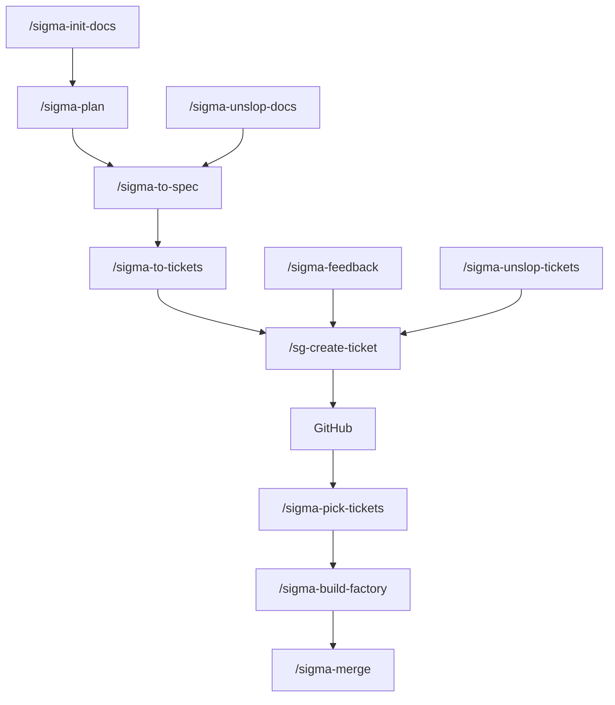

# sigma-build-factory

Agent skills for building Sigma work from a requirements document through to a merged pull request. Claude Code, Cursor, Codex, and any other agent that reads a `SKILL.md` folder can run them.

You keep the product decisions in one requirements file. Each command finishes and names the next command. The step lives in that skill.

Commands you type use the `sigma-` prefix. `/sigma-implement` starts `/sg-tdd`, `/sg-pr`, and `/sg-review`. The other commands start `/sg-create-ticket` when an issue must be filed or read.

Free to use under the [MIT license](LICENSE).

## Install

Clone the pack once, then link it into the skills folder your agent reads. Run the loop once for each agent you use.

| Agent | Set `SKILLS_DIR` to |
|---|---|
| Claude Code | `$HOME/.claude/skills` |
| Cursor | `$HOME/.cursor/skills` |
| Codex | `$HOME/.codex/skills` |
| Another agent that follows the shared layout | `$HOME/.agents/skills` |

```bash
git clone https://github.com/sigma-michael/sigma-build-factory.git "$HOME/sigma-build-factory"
export SKILLS_DIR="$HOME/.claude/skills"   # change this row to match the table
mkdir -p "$SKILLS_DIR"
for dir in "$HOME/sigma-build-factory"/sigma-* "$HOME/sigma-build-factory"/sg-*; do
  [ -f "$dir/SKILL.md" ] || continue
  ln -sfn "$dir" "$SKILLS_DIR/$(basename "$dir")"
done
```

Start a new session so the agent reloads skills. In Claude Code or Cursor, type the command, for example `/sigma-plan`. In an agent without slash commands, name the skill and ask it to follow that file.

To share the pack with a project instead of your user account, point the same loop at `.claude/skills`, `.cursor/skills`, or `.agents/skills` inside that repo.

The steps in each `SKILL.md` are the contract. Extra frontmatter such as `disable-model-invocation` and `allowed-tools` is a hint for agents that understand it. An agent that ignores those keys still follows the steps. If it cannot start another skill, and a step says to hand the body to `/sg-create-ticket`, follow that skill’s file. Do not create the GitHub issue from the calling skill.

## When to run which command

Run `/sigma-init-docs`, then `/sigma-plan`, `/sigma-to-spec`, `/sigma-to-tickets`, `/sg-create-ticket`, GitHub, `/sigma-pick-tickets`, `/sigma-build-factory`, and `/sigma-merge`. Start at `/sigma-init-docs` once, on a new work repo. `/sigma-feedback` files a note as a ticket. `/sigma-unslop-docs` rewrites the spec from the code. Those two lanes do not call each other. `/sigma-retro` is optional. It reviews one factory or implement session and does not block `/sigma-merge`.



Each command is one sentence here. The step lives in that skill.

| Command | What it does | Next |
|---|---|---|
| `/sigma-init-docs` | Copies the layout. Does not fill the product. | `/sigma-plan` |
| `/sigma-plan` | Asks one question in the chat and writes the requirements file after yes. | `/sigma-to-spec` |
| `/sigma-to-spec` | Writes one spec and waits for yes. | `/sigma-to-tickets` |
| `/sigma-to-tickets` | Files one ticket per visible result in the same turn. | `/sigma-pick-tickets` |
| `/sigma-pick-tickets` | Prints a numbered list of titles. | `/sigma-implement` or `/sigma-build-factory` |
| `/sigma-build-factory` | Builds that set on one factory branch and waits. | `/sigma-merge` |
| `/sigma-implement` | Builds one ticket and opens its pull request. A standalone pass fences `/sigma-merge`. A factory pass does not. | `/sigma-merge`, or the factory branch |
| `/sigma-merge` | Merges a `factory/` pull request. An `agent/` head stops. | the lane ends |
| `/sigma-feedback` | Files the note. A factory or implement chat returns it to the worker. A standalone chat fences `/sigma-plan` or `/sigma-pick-tickets`. | that fence, or the worker |
| `/sigma-unslop` | Writes one review and stops. | the command on each accepted finding |
| `/sigma-unslop-tickets` | A code worker marks completed or not in the code, then asks once. | `/sigma-pick-tickets` |
| `/sigma-unslop-docs` | Rewrites one spec from the code. | stop |
| `/sigma-retro` | Lists one skill fix and files it after you pick a row. | stop |
| `/sg-tdd` | Red, then green, on the locked script. | `/sg-pr` |
| `/sg-pr` | Opens one pull request and leaves it open. | `/sg-review` |
| `/sg-review` | Screenshots the live page. | `/sigma-implement` |
| `/sg-create-ticket` | The only issue writer. | the caller |

`/sg-create-ticket` is the only arrow into GitHub.

## Where files go

The work repo is the project you are building. This pack does not hold that project’s requirements or scripts.

| Path | Who writes it |
|---|---|
| `AGENTS.md`, `docs/README.md`, `.gitignore` | `/sigma-init-docs` |
| `docs/requirements/REQUIREMENTS.md` | `/sigma-plan` |
| `docs/reviews/<date>-<topic>.md` | `/sigma-unslop` |
| `scripts/**` named in the ticket | `/sg-tdd` |
| GitHub issues | `/sg-create-ticket` |

If a file fits none of these, the agent asks. It does not invent a new document.

## License

[MIT](LICENSE). Copyright (c) 2026 Michael Khmelik. You can use, copy, and change this pack, including in commercial work. Keep the copyright notice with your copy.
