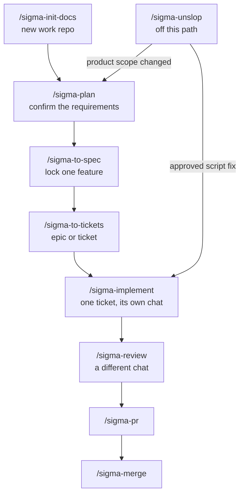

# sigma-build-factory

Agent skills for building Sigma work from a requirements document through to a merged pull request. Claude Code, Cursor, Codex, and any other agent that reads a `SKILL.md` folder can run them.

You keep the product decisions in one requirements file. The agent writes API scripts only where a ticket says it may. Each command finishes, tells you the next command, and waits. Review runs in a different chat from the chat that wrote the scripts.

The `sigma-` prefix keeps these commands distinct from other skill packs already installed on your machine.

Free to use under the [MIT license](LICENSE).

## Install

Clone the pack once, then link it into the skills folder your agent reads. Run the loop once for each agent you use.

| Agent | Set `SKILLS_DIR` to |
|---|---|
| Claude Code | `$HOME/.claude/skills` |
| Cursor | `$HOME/.cursor/skills` |
| Codex | `$HOME/.codex/skills` |
| Another agent that follows the shared layout | `$HOME/.agents/skills` |

```bash
git clone https://github.com/sigma-michael/sigma-build-factory.git "$HOME/sigma-build-factory"
export SKILLS_DIR="$HOME/.claude/skills"   # change this row to match the table
mkdir -p "$SKILLS_DIR"
for dir in "$HOME/sigma-build-factory"/sigma-*; do
  [ -f "$dir/SKILL.md" ] || continue
  ln -sfn "$dir" "$SKILLS_DIR/$(basename "$dir")"
done
```

Start a new session so the agent reloads skills. In Claude Code or Cursor, type the command, for example `/sigma-plan`. In an agent without slash commands, name the skill and ask it to follow that file.

To share the pack with a project instead of your user account, point the same loop at `.claude/skills`, `.cursor/skills`, or `.agents/skills` inside that repo.

The steps in each `SKILL.md` are the contract. Extra frontmatter such as `disable-model-invocation` and `allowed-tools` is a hint for agents that understand it. An agent that ignores those keys still follows the steps. If it cannot start another skill, and a step says to hand the body to `/sigma-create-ticket`, follow that skill’s file. Do not create the GitHub issue from the calling skill.

## When to run which command

Start at `/sigma-init-docs` once, on a new work repo. The next feature starts at `/sigma-plan`.



`/sigma-create-ticket` is not a step on this path. `/sigma-to-spec`, `/sigma-to-tickets`, and `/sigma-unslop` call it while they run. It files the issue and returns to that same command. It does not pick the next command, and it does not send unslop back to the spec.

| You ran | `/sigma-create-ticket` files | You run next |
|---|---|---|
| `/sigma-to-spec` | One spec | `/sigma-to-tickets` |
| `/sigma-to-tickets` | One issue for each epic or ticket | `/sigma-implement` for a ticket |
| `/sigma-unslop` | One ticket for each script fix you approved | `/sigma-implement` for that ticket |
| `/sigma-unslop`, and the finding changes the product | Nothing | `/sigma-plan` |

`/sigma-implement` refuses an epic. Split it with `/sigma-to-tickets` first. A fix after review goes back to `/sigma-implement` on the same branch, still in the builder chat.

## Skills

**You** means you name the command. On agents that support it, the agent does not start that skill by itself. **Agent** means another skill hands over a finished issue body, and the agent files it. You can still run `/sigma-create-ticket` yourself.

| Skill | Started by | When | What it does |
|---|---|---|---|
| `/sigma-init-docs` | You | The work repo has no layout yet | Copies the requirements file, `scripts/`, and the agent notes. Does not fill in the product. |
| `/sigma-plan` | You | You are deciding the solution, or a later feature changes it | Asks one question at a time and writes `docs/requirements/REQUIREMENTS.md` after you say yes. |
| `/sigma-to-spec` | You | The requirements for a feature are confirmed | Files one spec issue from that document, after you accept a short digest. |
| `/sigma-to-tickets` | You | A spec is ready to split | Turns concrete acceptance into a ticket, and a bundle that is still too broad into an epic. |
| `/sigma-create-ticket` | Agent | Called by `/sigma-to-spec`, `/sigma-to-tickets`, or `/sigma-unslop` | Files one GitHub issue and returns to the command that called it. |
| `/sigma-implement` | You | A ticket has a number | Builds that ticket on branch `agent/{N}-{slug}`, in its own chat, and pushes. It does not review its own work. |
| `/sigma-review` | You | The branch is pushed, and this is not the chat that built it | Reads the ticket, the spec, and the diff. Ready names `/sigma-pr`. Not ready sends you back to `/sigma-implement`. |
| `/sigma-pr` | You | Review says ready | Opens one pull request: `Closes #N`, a short summary, and what to look at. |
| `/sigma-merge` | You | You name the pull request numbers | Merges those pull requests, deletes the branch, and removes a clean worktree. |
| `/sigma-unslop` | You | API calls are duplicated, a wrapper hides the endpoint, or the requirements text is hard for an agent to follow | Writes one review note and files the fixes you approve. |

## Where files go

The work repo is the project you are building. This pack does not hold that project’s requirements or scripts.

| Path | Who writes it |
|---|---|
| `AGENTS.md`, `docs/README.md`, `.gitignore` | `/sigma-init-docs` |
| `docs/requirements/REQUIREMENTS.md` | `/sigma-plan` |
| `docs/reviews/<date>-<topic>.md` | `/sigma-unslop` |
| `scripts/**` named in the ticket | `/sigma-implement` |
| GitHub issues | `/sigma-create-ticket` |

If a file fits none of these, the agent asks. It does not invent a new document.

## License

[MIT](LICENSE). Copyright (c) 2026 Michael Khmelik. You can use, copy, and change this pack, including in commercial work. Keep the copyright notice with your copy.
