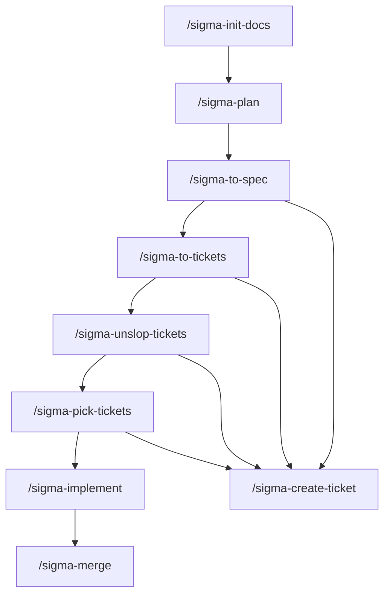
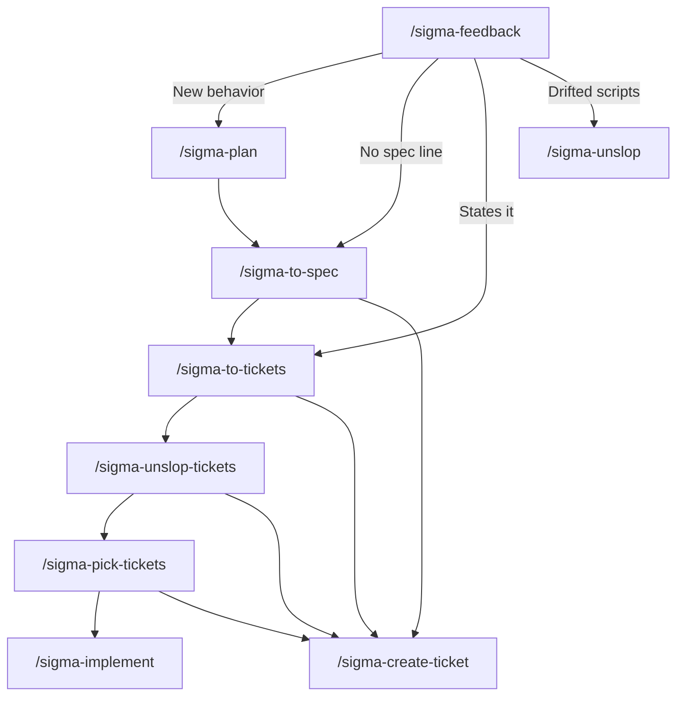
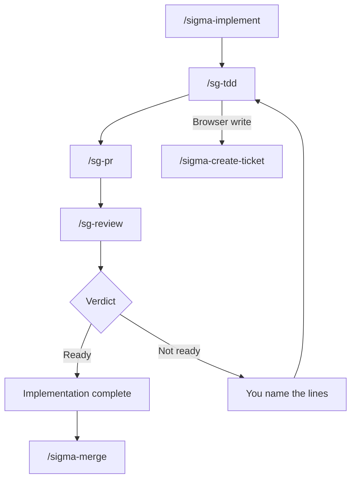

# sigma-build-factory

Agent skills for building Sigma work from a requirements document through to a merged pull request. Claude Code, Cursor, Codex, and any other agent that reads a `SKILL.md` folder can run them.

You keep the product decisions in one requirements file. The agent writes API scripts only where a ticket says it may. Each command finishes, tells you the next command, and waits. One worker writes the scripts and opens the pull request. A second worker reviews.

Commands you type use the `sigma-` prefix. `/sigma-implement` starts `/sg-tdd`, `/sg-pr`, and `/sg-review`. `/sigma-create-ticket` files issues for the commands that need one, and you can still run it yourself.

Free to use under the [MIT license](LICENSE).

## Install

Clone the pack once, then link it into the skills folder your agent reads. Run the loop once for each agent you use.

| Agent | Set `SKILLS_DIR` to |
|---|---|
| Claude Code | `$HOME/.claude/skills` |
| Cursor | `$HOME/.cursor/skills` |
| Codex | `$HOME/.codex/skills` |
| Another agent that follows the shared layout | `$HOME/.agents/skills` |

```bash
git clone https://github.com/sigma-michael/sigma-build-factory.git "$HOME/sigma-build-factory"
export SKILLS_DIR="$HOME/.claude/skills"   # change this row to match the table
mkdir -p "$SKILLS_DIR"
for dir in "$HOME/sigma-build-factory"/sigma-* "$HOME/sigma-build-factory"/sg-*; do
  [ -f "$dir/SKILL.md" ] || continue
  ln -sfn "$dir" "$SKILLS_DIR/$(basename "$dir")"
done
```

Start a new session so the agent reloads skills. In Claude Code or Cursor, type the command, for example `/sigma-plan`. In an agent without slash commands, name the skill and ask it to follow that file.

To share the pack with a project instead of your user account, point the same loop at `.claude/skills`, `.cursor/skills`, or `.agents/skills` inside that repo.

The steps in each `SKILL.md` are the contract. Extra frontmatter such as `disable-model-invocation` and `allowed-tools` is a hint for agents that understand it. An agent that ignores those keys still follows the steps. If it cannot start another skill, and a step says to hand the body to `/sigma-create-ticket`, follow that skill’s file. Do not create the GitHub issue from the calling skill.

## When to run which command

Start at `/sigma-init-docs` once, on a new work repo. A new feature then follows one path. A pasted note starts at `/sigma-feedback`. That command follows the matching skill in the same chat. The note does not become a ticket on its own.



`/sigma-to-spec` and `/sigma-to-tickets` hand the body to `/sigma-create-ticket`. Nothing else files an issue. When a spec or a ticket still has an old sentence, `/sigma-plan` shows one assumption. A yes updates those ids in the same chat. `/sigma-unslop-tickets` then cleans the open tickets. `/sigma-pick-tickets` names the first one to build. A normal build uses a ticket whose acceptance line was copied from a spec. Say overwrite and `/sigma-implement` continues the build.

### Where a note goes



A pasted note starts at `/sigma-feedback`. That command reads the requirements and the specs, then follows one skill in the same chat.

- New behavior, including a role the requirements do not mention, follows `/sigma-plan`. Plan asks the questions.
- A clear bug whose spec has no line follows `/sigma-to-spec`.
- A clear bug whose spec line already states that behavior follows `/sigma-to-tickets` with that spec number. The ticket copies the line. `/sigma-unslop-tickets` then cleans the open set. `/sigma-pick-tickets` names the first one to build. A topic argument keeps only the tickets that match those words.
- Drifted scripts follow `/sigma-unslop`. It writes `docs/reviews/<date>-<topic>.md` and stops. It does not file an issue.
- If you still want the build, say overwrite and `/sigma-implement` continues.

`/sigma-implement` flags an epic and names `/sigma-to-tickets`. Say overwrite and it chooses the script. When the ticket names no `scripts/` path, it picks the closest file, or one new file, and prints that path. A wrong file is a later `/sigma-unslop` review. That review does not edit the script.

### How a build finishes



You type `/sigma-implement`. It matches the ticket and opens the worktree. One worker follows `/sg-tdd`, then `/sg-pr`. A second worker follows `/sg-review`. That review screenshots the live page, and a script pass line is not enough. A script outside the spec globs is a note. The implement chat does not edit scripts and does not judge the diff.

- Ready prints implementation complete and names `/sigma-merge` with the pull request number from `/sg-pr`. That number is not the issue number.
- The decision says what the picture shows, what it does not, and whether the ticket intent is met. A met intent names `/sigma-merge` with the pull request number. A first miss sends those lines back on the same branch. A second miss stops and does not name `/sigma-merge`.

A browser write adds a comment through `/sigma-create-ticket`, and `/sigma-implement` prints the warning. The comment does not change acceptance lines. Review still runs. A ready verdict still names `/sigma-merge`, and that merge still merges the numbers you name.

## Skills

The first column is the command you type. A row with `none` describes that command. The next rows name each skill that command starts, and describe that skill.

| You type | System skill | What it does |
|---|---|---|
| `/sigma-init-docs` | none | Copies the requirements file, `scripts/`, and the agent notes. Does not fill in the product. |
| `/sigma-feedback` | none | Starts from `/sigma-feedback`, `sigma feedback`, or `do sigma feedback`, including a browser annotation. Reads the requirements and the specs, then follows one of `/sigma-plan`, `/sigma-to-spec`, `/sigma-to-tickets`, or `/sigma-unslop` in this chat. |
| `/sigma-feedback` | `/sigma-create-ticket` | Returns the spec list or one issue. Does not file. |
| `/sigma-plan` | none | Asks one question at a time and writes `docs/requirements/REQUIREMENTS.md` after you say yes. A confirmed acceptance is a numbered line. An edit pass shows each clash, suggests a change that still works, and asks what you want to do. A stale spec or ticket line is one assumption. |
| `/sigma-plan` | `/sigma-create-ticket` | Returns the spec list and the ticket list. It does not file. |
| `/sigma-plan` | `/sigma-to-spec` | After yes to the assumption, updates the named acceptance ids. It does not ask a second digest. |
| `/sigma-plan` | `/sigma-to-tickets` | After that same yes, updates tickets that already contain those ids. It does not ask grain and it does not create a ticket. |
| `/sigma-to-spec` | none | Writes one spec digest and waits for yes. It copies only numbered lines from the requirements file. A remaining clash is named and left out. The other lines are still offered for publish. |
| `/sigma-to-spec` | `/sigma-create-ticket` | Files or updates that spec. |
| `/sigma-to-tickets` | none | Copies numbered requirements lines from the spec onto tickets or epics and waits for one confirm. |
| `/sigma-to-tickets` | `/sigma-create-ticket` | Files those issues. |
| `/sigma-unslop-tickets` | none | Reads the open tickets, asks once about stale, duplicate, split, and missing blockers, then names `/sigma-pick-tickets`. An id that is not a numbered line names `/sigma-plan`. |
| `/sigma-unslop-tickets` | `/sigma-create-ticket` | After yes, closes, edits, or links a confirmed ticket. It does not create a spec or a ticket. |
| `/sigma-pick-tickets` | none | A topic keeps matching tickets. An empty argument lists the smallest closeable tickets first, then names one `/sigma-implement` number. A ticket whose id is not a numbered line stays out. |
| `/sigma-pick-tickets` | `/sigma-create-ticket` | Returns the open ticket list. It does not close, edit, or create. |
| `/sigma-create-ticket` | none | You can run it. It files a SPEC, EPIC, or TICKET whose body is already confirmed. |
| `/sigma-unslop` | none | Writes one review and stops. It does not file and it does not build. A pasted product note starts at `/sigma-feedback`. |
| `/sigma-implement` | none | Matches one ticket, opens the worktree, and prints the decision. When the ticket names no script, it chooses the closest file or one new path. It does not edit scripts and it does not judge the diff. |
| `/sigma-implement` | `/sg-tdd` | Runs red, then green, commits, and pushes. A rows-route 404 writes in the browser and the run continues. |
| `/sigma-implement` | `/sg-pr` | Opens one pull request on the pushed branch. Same worker as `/sg-tdd`. It does not wait for review. |
| `/sigma-implement` | `/sg-review` | A second worker screenshots the live page and compares it with the ticket. A script pass line is not enough. A script outside the spec globs is a note. An API-failed comment is not an unmet line. |
| `/sigma-implement` | `/sigma-create-ticket` | Posts one comment when the write used the browser. The comment does not replace the body. Review and merge still run. |
| `/sigma-merge` | none | Merges the pull request numbers you name, using the repository default method. It deletes the branch and removes a clean worktree. An API-failed comment does not drop a named number. |

## Where files go

The work repo is the project you are building. This pack does not hold that project’s requirements or scripts.

| Path | Who writes it |
|---|---|
| `AGENTS.md`, `docs/README.md`, `.gitignore` | `/sigma-init-docs` |
| `docs/requirements/REQUIREMENTS.md` | `/sigma-plan` |
| `docs/reviews/<date>-<topic>.md` | `/sigma-unslop` |
| `scripts/**` named in the ticket | `/sg-tdd` |
| GitHub issues | `/sigma-create-ticket` |

If a file fits none of these, the agent asks. It does not invent a new document.

## License

[MIT](LICENSE). Copyright (c) 2026 Michael Khmelik. You can use, copy, and change this pack, including in commercial work. Keep the copyright notice with your copy.
