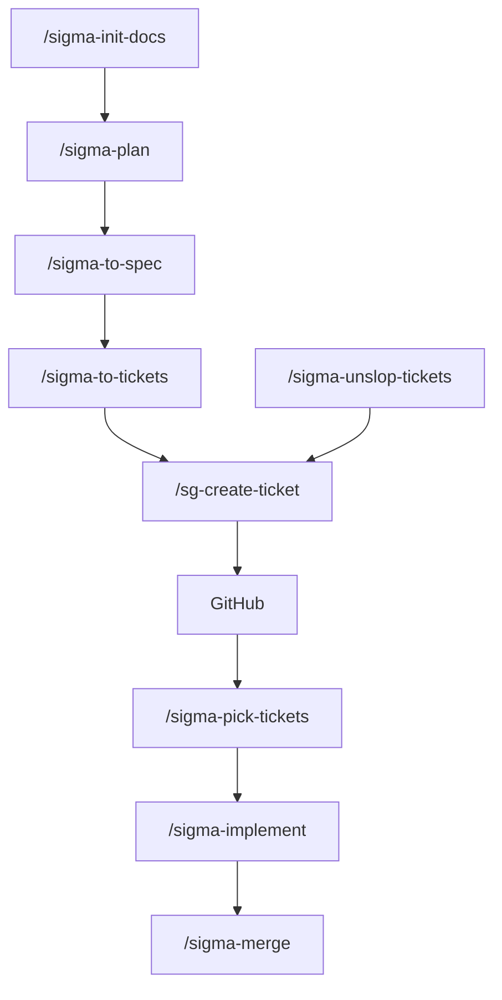
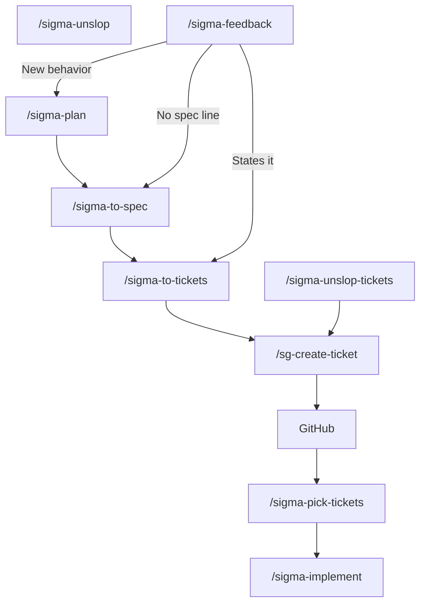
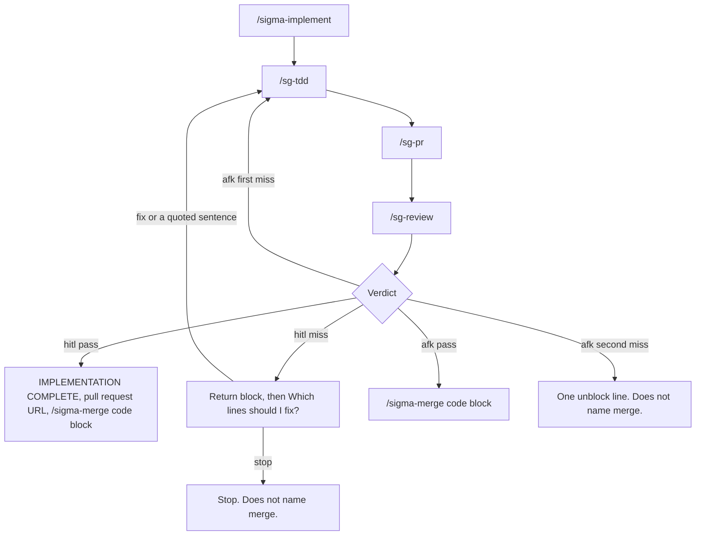

# sigma-build-factory

Agent skills for building Sigma work from a requirements document through to a merged pull request. Claude Code, Cursor, Codex, and any other agent that reads a `SKILL.md` folder can run them.

You keep the product decisions in one requirements file. The agent writes API scripts only where a ticket says it may. Each command finishes and tells you the next command. A next command is a fenced code block with only the command inside. One worker writes the scripts and opens the pull request. A second worker screenshots the live page and compares it with the ticket. A user run of `/sigma-implement` is `hitl`. A miss asks `Which lines should I fix?` and waits. The question is not a question card. A factory run is `afk`. It does not ask and does not wait. The first miss goes back once. A second miss stops and does not name merge.

Commands you type use the `sigma-` prefix. `/sigma-implement` starts `/sg-tdd`, `/sg-pr`, and `/sg-review`. The other commands start `/sg-create-ticket` when an issue must be filed or read.

Free to use under the [MIT license](LICENSE).

## Install

Clone the pack once, then link it into the skills folder your agent reads. Run the loop once for each agent you use.

| Agent | Set `SKILLS_DIR` to |
|---|---|
| Claude Code | `$HOME/.claude/skills` |
| Cursor | `$HOME/.cursor/skills` |
| Codex | `$HOME/.codex/skills` |
| Another agent that follows the shared layout | `$HOME/.agents/skills` |

```bash
git clone https://github.com/sigma-michael/sigma-build-factory.git "$HOME/sigma-build-factory"
export SKILLS_DIR="$HOME/.claude/skills"   # change this row to match the table
mkdir -p "$SKILLS_DIR"
for dir in "$HOME/sigma-build-factory"/sigma-* "$HOME/sigma-build-factory"/sg-*; do
  [ -f "$dir/SKILL.md" ] || continue
  ln -sfn "$dir" "$SKILLS_DIR/$(basename "$dir")"
done
```

Start a new session so the agent reloads skills. In Claude Code or Cursor, type the command, for example `/sigma-plan`. In an agent without slash commands, name the skill and ask it to follow that file.

To share the pack with a project instead of your user account, point the same loop at `.claude/skills`, `.cursor/skills`, or `.agents/skills` inside that repo.

The steps in each `SKILL.md` are the contract. Extra frontmatter such as `disable-model-invocation` and `allowed-tools` is a hint for agents that understand it. An agent that ignores those keys still follows the steps. If it cannot start another skill, and a step says to hand the body to `/sg-create-ticket`, follow that skill’s file. Do not create the GitHub issue from the calling skill.

## When to run which command

Run `/sigma-init-docs`, then `/sigma-plan`, `/sigma-to-spec`, `/sigma-to-tickets`, `/sg-create-ticket`, GitHub, `/sigma-pick-tickets`, `/sigma-implement`, and `/sigma-merge`. Start at `/sigma-init-docs` once, on a new work repo. `/sigma-feedback`, `/sigma-unslop-tickets`, and `/sigma-unslop` are three ways to start.



`/sigma-to-spec` and `/sigma-to-tickets` hand the body to `/sg-create-ticket`. `/sigma-unslop-tickets` closes, edits, or links through `/sg-create-ticket`. `/sg-create-ticket` is the only arrow into GitHub. GitHub continues to `/sigma-pick-tickets`. `/sigma-pick-tickets` orders tickets that already exist and prints a numbered list of titles. The next command is a fenced code block with only the command inside. One ticket uses `/sigma-implement` and that number. More than one uses `/sigma-build-factory` and every number. A confirmed feature with no SPEC ends at `/sigma-to-spec`. When a spec or a ticket still has an old sentence, `/sigma-plan` shows one assumption. A yes updates those ids in the same chat. Say overwrite and `/sigma-implement` continues a flagged build.

### Where a note goes

`/sigma-feedback`, `/sigma-unslop-tickets`, and `/sigma-unslop` are three ways to start. Feedback reads the requirements and the specs, then follows `/sigma-plan`, `/sigma-to-spec`, or `/sigma-to-tickets` in this chat.



1. New behavior, including a role the requirements do not mention, follows `/sigma-plan`. Plan asks one question at a time in the chat. The question is not a question card. The question is the last line.
2. A clear bug whose spec has no line follows `/sigma-to-spec`.
3. A clear bug whose spec line already states that behavior follows `/sigma-to-tickets` with that spec number. The ticket copies the line. `/sg-create-ticket` files it. `/sigma-pick-tickets` names the first filed ticket to build.
4. The user types `/sigma-unslop` for drifted scripts. It writes `docs/reviews/<date>-<topic>.md` and stops.
5. The user types `/sigma-unslop-tickets` to repair the open set. A yes closes, edits, or links through `/sg-create-ticket`. The reply names `/sigma-pick-tickets`.
6. Say overwrite and `/sigma-implement` continues a flagged build.

`/sigma-implement` flags an epic and names `/sigma-to-tickets`. Say overwrite and it chooses the script. When the ticket names no `scripts/` path, it picks the closest file, or one new file, and prints that path. A wrong file is a later `/sigma-unslop` review. That review does not edit the script.

### How a build finishes



You type `/sigma-implement`. It matches the ticket. It opens or creates `.worktrees/loop_<YYYY-MM-DD>-<slug>/issue-<N>/` on branch `agent/<N>-<slug>`. It reuses a `git worktree list` row already on that branch under `.worktrees/`. A new branch comes from `origin/<default>`, not the user's current branch. It writes `.worktrees/loop_<YYYY-MM-DD>-<slug>/worktrees.json` only when it creates the worktree. A fix stays on that same branch and worktree. `.worktrees/` must be gitignored. It does not edit `.gitignore`. One worker follows `/sg-tdd`, then `/sg-pr`. A second worker follows `/sg-review`. That review screenshots the live page. A script line that says pass is not evidence. A script outside the spec globs is a note. The implement chat does not edit scripts and does not judge the diff.

1. A user run of `/sigma-implement` is `hitl`. It prints What holds, What does not, Ticket intent, and Note. A pass prints `<promise>IMPLEMENTATION COMPLETE</promise>`, the pull request URL, and a fenced code block that contains only `/sigma-merge <pull-request-number>`, and does not ask. A miss prints the return block (Title, What holds, What does not, Ticket intent, Branch, Worktree, Pull request, Result `miss`), then the last line is `Which lines should I fix?`, then it waits. The question is not a question card. `fix` sends every What does not sentence. A quoted What does not sentence sends that sentence only. `stop` stops and does not name merge.
2. A factory run is `afk`. It does not ask and does not wait. A worker that would ask, or wait for `fix`, `stop`, `overwrite`, or `Which lines should I fix?`, stops that ticket. Other tickets continue. The first miss goes back once. A second miss stops and does not name merge. When the wave returns, the factory prints a table with Title, Result, and Next. Each review is then its own paragraphs: What holds, What does not, Ticket intent, and Worktree. A pass then prints a fenced code block that contains only `/sigma-merge <pull-request-number>`. A stop, or a ticket that never started, prints one unblock line and does not name merge.
3. The user's sentence replaces the old requirements line. No question about which line wins. A line the user reads starts with that sentence, then the sentence we will write. An issue number stays in the command the user will type.
4. A closed ticket the user says was not delivered is reopened, not duplicated.
5. A second flag of a passed acceptance opens with this sentence: `/sg-review and /sigma-implement both passed a page the user still rejects.`
6. Topic pickup reads the Topic line, the parent spec, and the numbered requirements line.

## Skills

The first column is the command you type. A row with `none` describes that command. The next rows name each skill that command starts, and describe that skill.

### Core flow

| You type | System skill | What it does |
|---|---|---|
| `/sigma-init-docs` | none | Copies the requirements file, `scripts/`, and the agent notes. Does not fill in the product. |
| `/sigma-plan` | none | Asks one question at a time in the chat and writes `docs/requirements/REQUIREMENTS.md` after you say yes. The question is not a question card. Before the question, the reply says what this step does, then `We have:` and `We will write:` when a line changes. The question is the last line. An id does not stand in for the sentence. A confirmed acceptance is a numbered line. An edit pass shows each clash, suggests a change that still works, and asks what you want to do. A stale spec or ticket line is one assumption. A confirmed feature with no SPEC ends at `/sigma-to-spec`. |
| `/sigma-plan` | `/sigma-to-spec` | After yes to the assumption, updates the named acceptance ids. It does not ask a second digest. |
| `/sigma-plan` | `/sigma-to-tickets` | After that same yes, updates tickets that already contain those ids. It does not ask grain and it does not create a ticket. |
| `/sigma-to-spec` | none | Writes one spec digest and waits for yes. The question is asked in the chat. It is not a question card. Before the question, the reply says what this step does, then `We have:` and `We will write:` when a line changes. The question is the last line. An id does not stand in for the sentence. It copies only numbered lines from the requirements file. A remaining clash is named and left out. The other lines are still offered for publish. |
| `/sigma-to-tickets` | none | Copies numbered requirements lines from the spec onto tickets or epics and waits for one confirm. The question is asked in the chat. It is not a question card. Before the question, the reply says what this step does, then `We have:` and `We will write:` when a line changes. The question is the last line. An id does not stand in for the sentence. After filing, it names `/sigma-pick-tickets`. |
| `/sigma-pick-tickets` | none | A topic keeps matching tickets. An empty argument lists the smallest closeable tickets first. The reply is a numbered list of titles and does not print the acceptance body. The next command is a fenced code block with only the command inside. One ticket uses `/sigma-implement` and that number. More than one uses `/sigma-build-factory` and every number. A ticket whose id is not a numbered line stays out. A title that uses a word the acceptance line and the requirements line do not use stays out. |
| `/sigma-build-factory` | `/sigma-implement` | Runs the numbers `/sigma-pick-tickets` printed. One worker builds each ticket in `afk`. It does not ask and does not wait. A worker that would ask, or wait for `fix`, `stop`, `overwrite`, or `Which lines should I fix?`, stops that ticket. Other tickets continue. The first miss goes back once. A second miss stops and does not name merge. When the wave returns, the factory prints a table with Title, Result, and Next, then each review as separate paragraphs. A pass then prints a fenced code block that contains only `/sigma-merge <pull-request-number>`. A stop, or a ticket that never started, prints one unblock line and does not name merge. A title that uses a word the acceptance line and the requirements line do not use stops that ticket before a worker starts. It does not become a branch or a script. Other tickets still start. A numbered line must already be on `origin/main`. |
| `/sigma-implement` | none | Matches one ticket. It opens or creates `.worktrees/loop_<YYYY-MM-DD>-<slug>/issue-<N>/` on branch `agent/<N>-<slug>`. It reuses a `git worktree list` row already on that branch under `.worktrees/`. A new branch comes from `origin/<default>`, not the user's current branch. It writes `.worktrees/loop_<YYYY-MM-DD>-<slug>/worktrees.json` only when it creates the worktree. A fix stays on that same branch and worktree. `.worktrees/` must be gitignored. It does not edit `.gitignore`. A title that uses a word the acceptance line and the requirements line do not use stops before the branch and the script. The old git branch stays. A user run is `hitl`. It prints What holds, What does not, Ticket intent, and Note. A pass prints `<promise>IMPLEMENTATION COMPLETE</promise>`, the pull request URL, and a fenced code block that contains only `/sigma-merge <pull-request-number>`, and does not ask. A miss prints the return block (Title, What holds, What does not, Ticket intent, Branch, Worktree, Pull request, Result `miss`), then the last line is `Which lines should I fix?`, then it waits. The question is not a question card. `fix` sends every What does not sentence. A quoted What does not sentence sends that sentence only. `stop` stops and does not name merge. When the ticket names no script, it chooses the closest file or one new path. It does not edit scripts and it does not judge the diff. |
| `/sigma-implement` | `/sg-tdd` | Runs red, then green, commits, and pushes. On a fix, every What does not sentence is the miss. A quoted What does not sentence is that sentence only. An existing script pass does not close it. A rows-route 404 writes in the browser and the run continues. |
| `/sigma-implement` | `/sg-pr` | Opens one pull request on the pushed branch. Same worker as `/sg-tdd`. It does not wait for review. |
| `/sigma-implement` | `/sg-review` | A second worker screenshots the live page and compares it with the ticket. A script line that says pass is not evidence. A script outside the spec globs is a note. An API-failed comment stays a note. The screenshot decides the line. |
| `/sigma-merge` | none | Merges the pull request numbers you name, using the repository default method. It deletes the branch and removes a clean worktree. An API-failed comment does not drop a named number. |

### Ticket writers

`/sigma-to-tickets` and `/sigma-unslop-tickets` both call `/sg-create-ticket`. That command is the only arrow into GitHub.

| You type | System skill | What it does |
|---|---|---|
| `/sigma-to-tickets` | `/sg-create-ticket` | Files those issues. The issues land on GitHub. Next is `/sigma-pick-tickets`. |
| `/sigma-unslop-tickets` | none | The user starts this to repair the open set. It asks once, in the chat, about stale, duplicate, split, and missing blockers, then names `/sigma-pick-tickets`. The question is not a question card. It is the last line. An id that is not a numbered line names `/sigma-plan`. |
| `/sigma-unslop-tickets` | `/sg-create-ticket` | After yes, closes, edits, or links a confirmed ticket. It does not create a spec or a ticket. |
| `/sg-create-ticket` | none | Other skills start this command. A spec names `/sigma-to-tickets`. A ticket or an epic names `/sigma-pick-tickets`. |

### Entrances

| You type | System skill | What it does |
|---|---|---|
| `/sigma-feedback` | none | Starts from `/sigma-feedback`, `sigma feedback`, or `do sigma feedback`, including a browser annotation. Reads the requirements and the specs, then follows one of `/sigma-plan`, `/sigma-to-spec`, or `/sigma-to-tickets` in this chat. |
| `/sigma-feedback` | `/sg-create-ticket` | Returns the spec list or one issue. Does not file. |
| `/sigma-unslop` | none | The user types this command. It writes one review and stops. It does not file and it does not build. |

### System writer

`/sg-create-ticket` is the only skill that runs `gh`. These commands call it.

| You type | System skill | What it does |
|---|---|---|
| `/sigma-feedback` | `/sg-create-ticket` | Returns the spec list or one issue. Does not file. |
| `/sigma-plan` | `/sg-create-ticket` | Returns the spec list and the ticket list. It does not file. |
| `/sigma-to-spec` | `/sg-create-ticket` | Files or updates that spec. |
| `/sigma-to-tickets` | `/sg-create-ticket` | Files those issues. |
| `/sigma-unslop-tickets` | `/sg-create-ticket` | After yes, closes, edits, or links a confirmed ticket. |
| `/sg-tdd` | `/sg-create-ticket` | Posts one comment when the write used the browser. The comment does not replace the body. Review and merge still run. |

## Where files go

The work repo is the project you are building. This pack does not hold that project’s requirements or scripts.

| Path | Who writes it |
|---|---|
| `AGENTS.md`, `docs/README.md`, `.gitignore` | `/sigma-init-docs` |
| `docs/requirements/REQUIREMENTS.md` | `/sigma-plan` |
| `docs/reviews/<date>-<topic>.md` | `/sigma-unslop` |
| `scripts/**` named in the ticket | `/sg-tdd` |
| GitHub issues | `/sg-create-ticket` |

If a file fits none of these, the agent asks. It does not invent a new document.

## License

[MIT](LICENSE). Copyright (c) 2026 Michael Khmelik. You can use, copy, and change this pack, including in commercial work. Keep the copyright notice with your copy.
