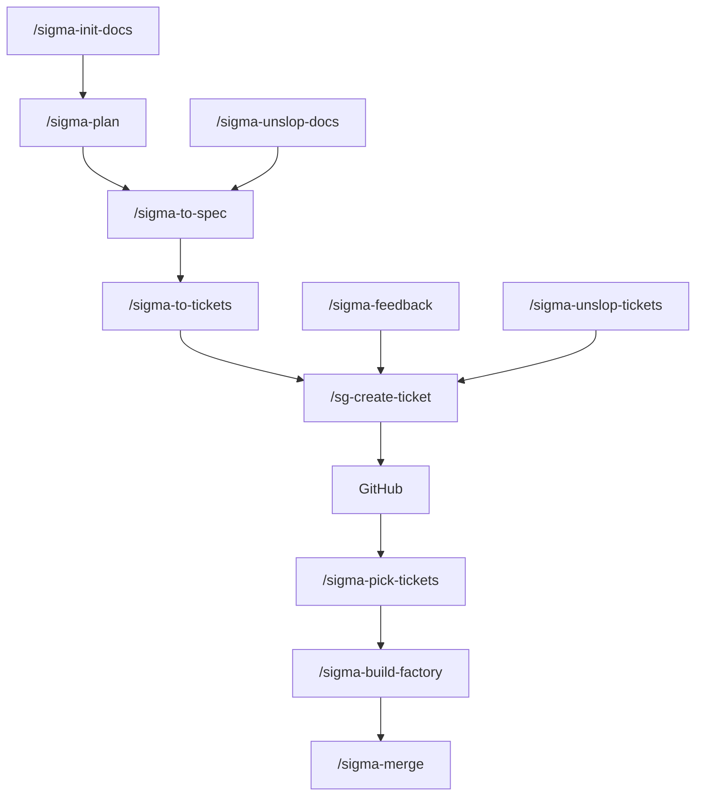
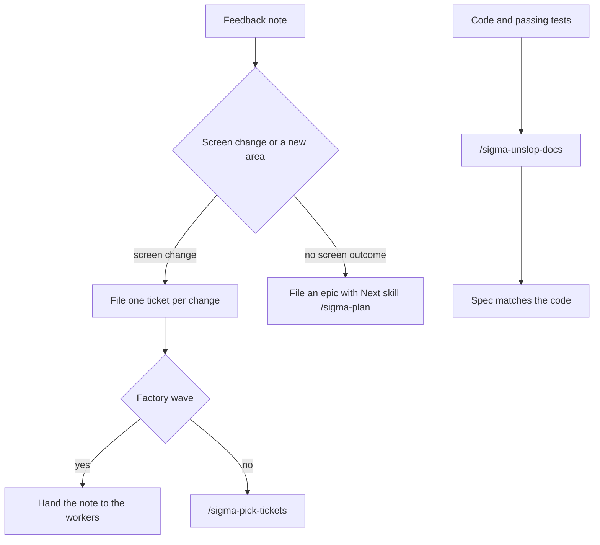
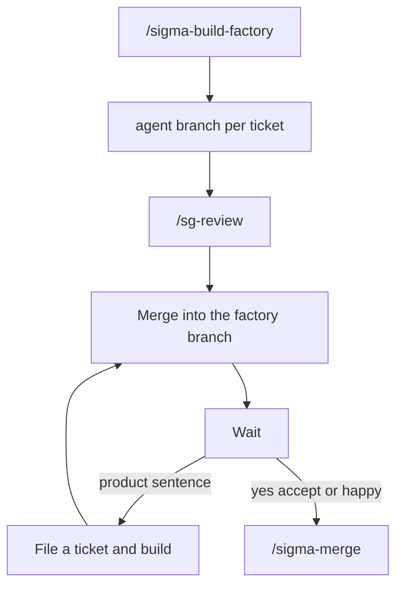

# sigma-build-factory

Agent skills for building Sigma work from a requirements document through to a merged pull request. Claude Code, Cursor, Codex, and any other agent that reads a `SKILL.md` folder can run them.

You keep the product decisions in one requirements file. The agent writes API scripts only where a ticket says it may. Each command finishes and tells you the next command. A next command is a fenced code block with only the command inside. One worker writes the scripts and opens the pull request. A second worker screenshots the live page and compares it with the ticket. A user run of `/sigma-implement` is `hitl`. A miss asks `Which lines should I fix?` and waits. The question is not a question card. A factory run builds on one factory branch and waits after the tickets are merged into it. A product sentence is filed as a ticket and handed to the workers. Main changes only after you accept.

Commands you type use the `sigma-` prefix. `/sigma-implement` starts `/sg-tdd`, `/sg-pr`, and `/sg-review`. The other commands start `/sg-create-ticket` when an issue must be filed or read.

Free to use under the [MIT license](LICENSE).

## Install

Clone the pack once, then link it into the skills folder your agent reads. Run the loop once for each agent you use.

| Agent | Set `SKILLS_DIR` to |
|---|---|
| Claude Code | `$HOME/.claude/skills` |
| Cursor | `$HOME/.cursor/skills` |
| Codex | `$HOME/.codex/skills` |
| Another agent that follows the shared layout | `$HOME/.agents/skills` |

```bash
git clone https://github.com/sigma-michael/sigma-build-factory.git "$HOME/sigma-build-factory"
export SKILLS_DIR="$HOME/.claude/skills"   # change this row to match the table
mkdir -p "$SKILLS_DIR"
for dir in "$HOME/sigma-build-factory"/sigma-* "$HOME/sigma-build-factory"/sg-*; do
  [ -f "$dir/SKILL.md" ] || continue
  ln -sfn "$dir" "$SKILLS_DIR/$(basename "$dir")"
done
```

Start a new session so the agent reloads skills. In Claude Code or Cursor, type the command, for example `/sigma-plan`. In an agent without slash commands, name the skill and ask it to follow that file.

To share the pack with a project instead of your user account, point the same loop at `.claude/skills`, `.cursor/skills`, or `.agents/skills` inside that repo.

The steps in each `SKILL.md` are the contract. Extra frontmatter such as `disable-model-invocation` and `allowed-tools` is a hint for agents that understand it. An agent that ignores those keys still follows the steps. If it cannot start another skill, and a step says to hand the body to `/sg-create-ticket`, follow that skill’s file. Do not create the GitHub issue from the calling skill.

## When to run which command

Run `/sigma-init-docs`, then `/sigma-plan`, `/sigma-to-spec`, `/sigma-to-tickets`, `/sg-create-ticket`, GitHub, `/sigma-pick-tickets`, `/sigma-build-factory`, and `/sigma-merge`. Start at `/sigma-init-docs` once, on a new work repo. `/sigma-feedback` files a note as a ticket. `/sigma-unslop-docs` rewrites the spec from the code. Those two lanes do not call each other.



`/sigma-to-spec` and `/sigma-to-tickets` hand the body to `/sg-create-ticket`. `/sigma-unslop-tickets` closes, edits, or links through `/sg-create-ticket`. `/sg-create-ticket` is the only arrow into GitHub. GitHub continues to `/sigma-pick-tickets`. `/sigma-pick-tickets` orders tickets that already exist and prints a numbered list of titles. The next command is a fenced code block with only the command inside. One ticket uses `/sigma-implement` and that number. More than one uses `/sigma-build-factory` and every number. A confirmed feature with no SPEC ends at `/sigma-to-spec`. A `type:ticket` builds from the sentences in its body. A missing requirements line does not stop it. A spec or an epic is too big for one build.

### Where a note goes

Feedback and document repair are two lanes. They do not call each other. `/sigma-feedback` files each screen change as a ticket and does not edit requirements or a spec. Several screens are several tickets. An epic is only a new area with no screen outcome, and its body says `Next skill: /sigma-plan`. When this chat has a factory branch, each ticket is built by a worker. `/sigma-unslop-docs` later rewrites the spec from the code, the passing tests, and the closed tickets the code shows.



1. A feedback note that is one outcome is filed as a ticket. The acceptance sentence is the note. Requirements and the spec stay as they are.
2. A feedback note with no screen outcome is filed as an epic. The body says `Next skill: /sigma-plan`. Feedback does not start that skill. Several screen changes are several tickets.
3. When this chat has a factory branch, that ticket is handed to the workers and built. With no factory branch, the fence contains only `/sigma-pick-tickets`.
4. The user types `/sigma-unslop` for drifted scripts. It writes `docs/reviews/<date>-<topic>.md` and stops.
5. The user types `/sigma-unslop-tickets` to repair the open set. A yes closes, edits, or links through `/sg-create-ticket`. The reply names `/sigma-pick-tickets`.
6. A `type:ticket` starts from the sentences in its body. A missing requirements line does not send it to `/sigma-plan`.

`/sigma-implement` does not build a spec or an epic. Screen outcomes name `/sigma-to-tickets`. No screen outcome names `/sigma-plan`. When the ticket names no `scripts/` path, it picks the closest file, or one new file, and prints that path. A wrong file is a later `/sigma-unslop` review. That review does not edit the script.

### How a build finishes



The diagram is a factory run. Ticket branches merge into the factory branch. The chat waits. A product sentence is filed and built. Yes, accept, or happy prints `/sigma-merge` for that one pull request.

You type `/sigma-implement` on one ticket outside a factory run. It matches the ticket. It opens or creates `.worktrees/loop_<YYYY-MM-DD>-<slug>/issue-<N>/` on branch `agent/<N>-<slug>`. It reuses a `git worktree list` row already on that branch under `.worktrees/`. A new branch comes from `origin/<default>`, not the user's current branch. It writes `.worktrees/loop_<YYYY-MM-DD>-<slug>/worktrees.json` only when it creates the worktree. A fix stays on that same branch and worktree. `.worktrees/` must be gitignored. It does not edit `.gitignore`. One worker follows `/sg-tdd`, then `/sg-pr`. A second worker follows `/sg-review`. That review screenshots the live page. A script line that says pass is not evidence. A script outside the spec globs is a note. The implement chat does not edit scripts and does not judge the diff.

1. A user run of `/sigma-implement` is `hitl`. It prints What holds, What does not, Ticket intent, and Note. A pass prints `<promise>IMPLEMENTATION COMPLETE</promise>`, the pull request URL, and a fenced code block that contains only `/sigma-merge <pull-request-number>`, and does not ask. A miss prints the return block (Title, What holds, What does not, Ticket intent, Branch, Worktree, Pull request, Result `miss`), then the last line is `Which lines should I fix?`, then it waits. The question is not a question card. `fix` sends every What does not sentence. A quoted What does not sentence sends that sentence only. `stop` stops and does not name merge.
2. A factory run is `afk`. It does not ask and does not wait. A worker that would ask, or wait for `fix`, `stop`, `overwrite`, or `Which lines should I fix?`, stops that ticket. Other tickets continue. The first miss goes back once. A second miss stops and does not name merge. When the wave returns, the factory prints one table. Columns are Title, Does, Outcome, and Status. Each cell is one sentence. Status is Met or Not met. A pass then prints a fenced code block that contains only `/sigma-merge <pull-request-number>`.
3. The user's sentence replaces the old requirements line. No question about which line wins. A line the user reads starts with that sentence, then the sentence we will write. An issue number stays in the command the user will type.
4. A closed ticket the user says was not delivered is reopened, not duplicated.
5. A second flag of a passed acceptance opens with this sentence: `/sg-review and /sigma-implement both passed a page the user still rejects.`
6. Topic pickup reads the Topic line, the parent spec, and the numbered requirements line.

## Skills

The first column is the command you type. A row with `none` describes that command. The next rows name each skill that command starts, and describe that skill.

### Core flow

| You type | System skill | What it does |
|---|---|---|
| `/sigma-init-docs` | none | Copies the requirements file, `scripts/`, and the agent notes. Does not fill in the product. |
| `/sigma-plan` | none | Asks one question at a time in the chat and writes `docs/requirements/REQUIREMENTS.md` after you say yes. The question is not a question card. Before the question, the reply says what this step does, then `We have:` and `We will write:` when a line changes. The question is the last line. An id does not stand in for the sentence. A confirmed acceptance is a numbered line. An edit pass shows each clash, suggests a change that still works, and asks what you want to do. A stale spec or ticket line is one assumption. A confirmed feature with no SPEC ends at `/sigma-to-spec`. |
| `/sigma-plan` | `/sigma-to-spec` | After yes to the assumption, updates the named acceptance ids. It does not ask a second digest. |
| `/sigma-plan` | `/sigma-to-tickets` | After that same yes, updates tickets that already contain those ids. It does not ask grain and it does not create a ticket. |
| `/sigma-to-spec` | none | Writes one spec digest and waits for yes. The question is asked in the chat. It is not a question card. Before the question, the reply says what this step does, then `We have:` and `We will write:` when a line changes. The question is the last line. An id does not stand in for the sentence. It copies only numbered lines from the requirements file. A remaining clash is named and left out. The other lines are still offered for publish. |
| `/sigma-to-tickets` | none | Copies a clear spec onto tickets and files them in the same turn. One ticket is one outcome an implement can build. Sentences for that same page stay together. The reply shows that cut and does not ask the user to confirm it. After filing, it names `/sigma-pick-tickets`. |
| `/sigma-pick-tickets` | none | A topic keeps matching tickets. An empty argument lists the smallest closeable tickets first. The reply is a numbered list of titles and does not print the acceptance body. The next command is a fenced code block with only the command inside. One ticket uses `/sigma-implement` and that number. More than one uses `/sigma-build-factory` and every number. It matches the task to the outcome in the ticket, the spec, and the requirements lines. A missing requirements line does not keep a ticket out. It does not judge titles or lines. That is `/sigma-unslop-tickets`. When the outcome is specified and no ticket carries it, the fence holds only `/sigma-to-tickets`. |
| `/sigma-build-factory` | `/sigma-implement` | Builds each `type:ticket` from the sentences in its body on `factory/<YYYY-MM-DD>-<slug>`. A missing requirements line does not stop a ticket. A spec or an epic is too big and does not start. Each ticket uses `agent/<N>-<slug>` from that factory branch. A pass merges the agent branch into the factory branch. One pull request tracks the factory branch into main. The chat waits. A product sentence goes back to the matching workers. The words yes, accept, or happy print a fenced code block that contains only `/sigma-merge` and that pull request number. This command does not merge into main. A stale title stops that ticket before a worker starts. |
| `/sigma-implement` | none | Matches one ticket. It opens or creates `.worktrees/loop_<YYYY-MM-DD>-<slug>/issue-<N>/` on branch `agent/<N>-<slug>`. It reuses a `git worktree list` row already on that branch under `.worktrees/`. A new branch comes from `origin/<default>`, not the user's current branch. It writes `.worktrees/loop_<YYYY-MM-DD>-<slug>/worktrees.json` only when it creates the worktree. A fix stays on that same branch and worktree. `.worktrees/` must be gitignored. It does not edit `.gitignore`. A title stops before the branch and the script only when it still uses a word the current line replaced. The stop names the word the title should use. The old git branch stays. A user run is `hitl`. It prints What holds, What does not, Ticket intent, and Note. A pass prints `<promise>IMPLEMENTATION COMPLETE</promise>`, the pull request URL, and a fenced code block that contains only `/sigma-merge <pull-request-number>`, and does not ask. A miss prints the return block (Title, What holds, What does not, Ticket intent, Branch, Worktree, Pull request, Result `miss`), then the last line is `Which lines should I fix?`, then it waits. The question is not a question card. `fix` sends every What does not sentence. A quoted What does not sentence sends that sentence only. `stop` stops and does not name merge. When the ticket names no script, it chooses the closest file or one new path. It does not edit scripts and it does not judge the diff. |
| `/sigma-implement` | `/sg-tdd` | Runs red, then green, commits, and pushes. On a fix, every What does not sentence is the miss. A quoted What does not sentence is that sentence only. An existing script pass does not close it. A rows-route 404 writes in the browser and the run continues. |
| `/sigma-implement` | `/sg-pr` | Opens one pull request on the pushed branch. Same worker as `/sg-tdd`. It does not wait for review. |
| `/sigma-implement` | `/sg-review` | A second worker screenshots the live page and compares it with the ticket. A script line that says pass is not evidence. A script outside the spec globs is a note. An API-failed comment stays a note. The screenshot decides the line. |
| `/sigma-merge` | none | Merges the pull request numbers you name, using the repository default method. It deletes the branch and removes a clean worktree. An API-failed comment does not drop a named number. |

### Ticket writers

`/sigma-to-tickets` and `/sigma-unslop-tickets` both call `/sg-create-ticket`. That command is the only arrow into GitHub.

| You type | System skill | What it does |
|---|---|---|
| `/sigma-to-tickets` | `/sg-create-ticket` | Files those issues. The issues land on GitHub. Next is `/sigma-pick-tickets`. |
| `/sigma-unslop-tickets` | none | The user starts this to repair the open set. It asks once, in the chat, about stale, duplicate, split, and missing blockers, then names `/sigma-pick-tickets`. The question is not a question card. It is the last line. An id that is not a numbered line names `/sigma-plan`. |
| `/sigma-unslop-tickets` | `/sg-create-ticket` | After yes, closes, edits, or links a confirmed ticket. It does not create a spec or a ticket. |
| `/sg-create-ticket` | none | Other skills start this command. A spec names `/sigma-to-tickets`. A ticket or an epic names `/sigma-pick-tickets`. |

### Entrances

| You type | System skill | What it does |
|---|---|---|
| `/sigma-feedback` | none | Starts from `/sigma-feedback`, `sigma feedback`, or `do sigma feedback`, including a browser annotation. Files the note as a ticket or an epic. Does not edit requirements or a spec. A factory ticket is also built. |
| `/sigma-feedback` | `/sg-create-ticket` | Files one ticket per screen change. An epic is only a new area with no screen outcome, and it includes `Next skill: /sigma-plan`. |
| `/sigma-unslop-docs` | none | Rewrites one spec from the scripts, the passing tests, and the closed tickets the code shows. A closed ticket with no code is left out. Does not file a ticket and does not build. |
| `/sigma-unslop` | none | The user types this command. It writes one review and stops. It does not file and it does not build. |

### System writer

`/sg-create-ticket` is the only skill that runs `gh`. These commands call it.

| You type | System skill | What it does |
|---|---|---|
| `/sigma-feedback` | `/sg-create-ticket` | Files one ticket or one epic from the note. Does not file a spec. |
| `/sigma-unslop-docs` | `/sg-create-ticket` | Updates one spec body from the code. Does not file a ticket. |
| `/sigma-plan` | `/sg-create-ticket` | Returns the spec list and the ticket list. It does not file. |
| `/sigma-to-spec` | `/sg-create-ticket` | Files or updates that spec. |
| `/sigma-to-tickets` | `/sg-create-ticket` | Files those issues. |
| `/sigma-unslop-tickets` | `/sg-create-ticket` | After yes, closes, edits, or links a confirmed ticket. |
| `/sg-tdd` | `/sg-create-ticket` | Posts one comment when the write used the browser. The comment does not replace the body. Review and merge still run. |

## Where files go

The work repo is the project you are building. This pack does not hold that project’s requirements or scripts.

| Path | Who writes it |
|---|---|
| `AGENTS.md`, `docs/README.md`, `.gitignore` | `/sigma-init-docs` |
| `docs/requirements/REQUIREMENTS.md` | `/sigma-plan` |
| `docs/reviews/<date>-<topic>.md` | `/sigma-unslop` |
| `scripts/**` named in the ticket | `/sg-tdd` |
| GitHub issues | `/sg-create-ticket` |

If a file fits none of these, the agent asks. It does not invent a new document.

## License

[MIT](LICENSE). Copyright (c) 2026 Michael Khmelik. You can use, copy, and change this pack, including in commercial work. Keep the copyright notice with your copy.
