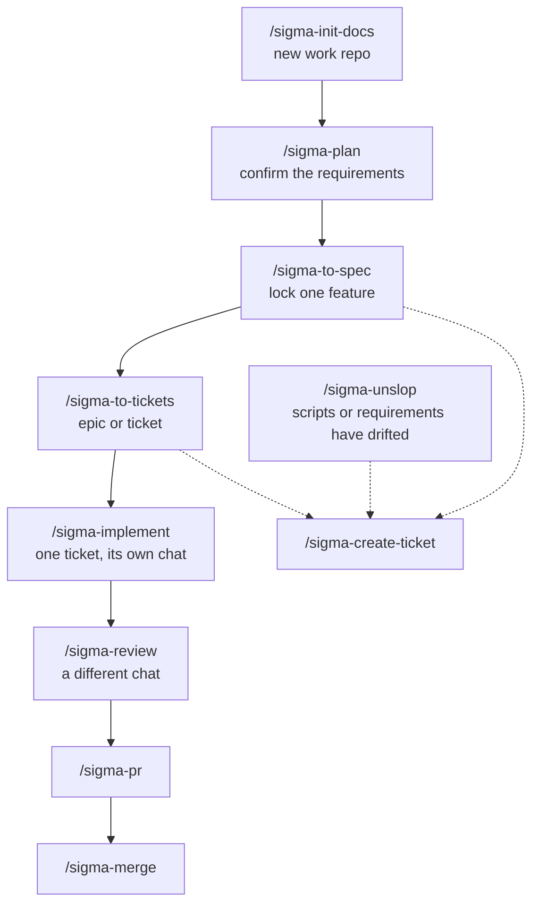

# sigma-build-factory

Cursor skills for building Sigma work from a requirements document through to a merged pull request.

You keep the product decisions in one requirements file. The agent writes API scripts only where a ticket says it may. Each command finishes, tells you the next command, and waits. Review runs in a different chat from the chat that wrote the scripts.

The `sigma-` prefix keeps these commands distinct from other skill packs already installed on your machine.

Free to use under the [MIT license](LICENSE).

## Install

Clone the pack and link each skill into Cursor’s skills folder:

```bash
git clone https://github.com/sigma-michael/sigma-build-factory.git "$HOME/sigma-build-factory"
mkdir -p "$HOME/.cursor/skills"
for dir in "$HOME/sigma-build-factory"/sigma-*; do
  [ -f "$dir/SKILL.md" ] || continue
  ln -sfn "$dir" "$HOME/.cursor/skills/$(basename "$dir")"
done
```

Open a new Cursor chat. The commands in the table below are available there.

Cursor reads `~/.cursor/skills` when a chat starts. Leave `~/.cursor/skills-cursor/` unchanged. For Claude Code, run the same loop with `~/.claude/skills` as the destination.

## When to run which command

Start at `/sigma-init-docs` once, on a new work repo. The next feature starts at `/sigma-plan`. `/sigma-unslop` can run whenever the scripts or the requirements doc have drifted. It is not a step on the feature path.

Solid arrows are commands you type. Dotted arrows are the agent filing a GitHub issue for you.



`/sigma-implement` refuses an epic. Split it with `/sigma-to-tickets` first. A fix after review goes back to `/sigma-implement` on the same branch, still in the builder chat.

## Skills

**You** means you type the command. The agent does not start it. **Agent** means another skill hands over a finished issue body, and the agent files it. You can still type `/sigma-create-ticket` yourself.

| Skill | Started by | When | What it does |
|---|---|---|---|
| `/sigma-init-docs` | You | The work repo has no layout yet | Copies the requirements file, `scripts/`, and the agent notes. Does not fill in the product. |
| `/sigma-plan` | You | You are deciding the solution, or a later feature changes it | Asks one question at a time and writes `docs/requirements/REQUIREMENTS.md` after you say yes. |
| `/sigma-to-spec` | You | The requirements for a feature are confirmed | Files one spec issue from that document, after you accept a short digest. |
| `/sigma-to-tickets` | You | A spec is ready to split | Turns concrete acceptance into a ticket, and a bundle that is still too broad into an epic. |
| `/sigma-create-ticket` | Agent | A spec, a ticket, or an unslop fix is ready to file | The only skill that creates or edits a GitHub issue. |
| `/sigma-implement` | You | A ticket has a number | Builds that ticket on branch `agent/{N}-{slug}`, in its own chat, and pushes. It does not review its own work. |
| `/sigma-review` | You | The branch is pushed, and this is not the chat that built it | Reads the ticket, the spec, and the diff. Ready names `/sigma-pr`. Not ready sends you back to `/sigma-implement`. |
| `/sigma-pr` | You | Review says ready | Opens one pull request: `Closes #N`, a short summary, and what to look at. |
| `/sigma-merge` | You | You name the pull request numbers | Merges those pull requests, deletes the branch, and removes a clean worktree. |
| `/sigma-unslop` | You | API calls are duplicated, a wrapper hides the endpoint, or the requirements text is hard for an agent to follow | Writes one review note and files the fixes you approve. |

## Where files go

The work repo is the project you are building. This pack does not hold that project’s requirements or scripts.

| Path | Who writes it |
|---|---|
| `AGENTS.md`, `docs/README.md`, `.gitignore` | `/sigma-init-docs` |
| `docs/requirements/REQUIREMENTS.md` | `/sigma-plan` |
| `docs/reviews/<date>-<topic>.md` | `/sigma-unslop` |
| `scripts/**` named in the ticket | `/sigma-implement` |
| GitHub issues | `/sigma-create-ticket` |

If a file fits none of these, the agent asks. It does not invent a new document.

## License

[MIT](LICENSE). Copyright (c) 2026 Michael Khmelik. You can use, copy, and change this pack, including in commercial work. Keep the copyright notice with your copy.
